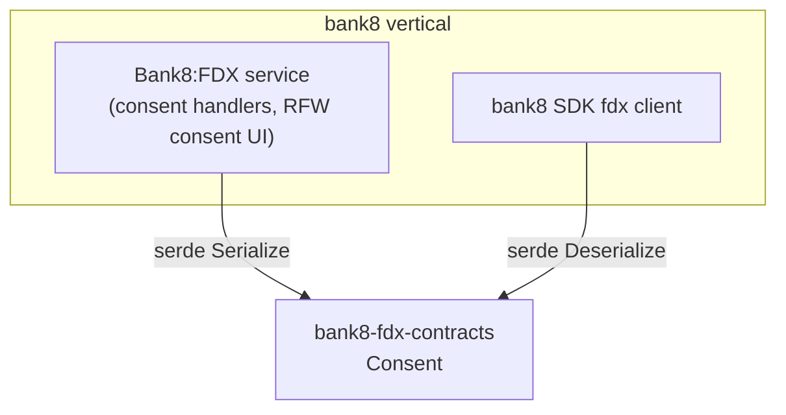

# bank8-fdx-contracts

Wire types for the Bank8:FDX open-banking HTTP API (FDX v6.5) - the
shared vocabulary between the FDX service, the `bank8` SDK client, and
any Rust consumer of the consent surface.

## 1. Summary

`bank8-fdx-contracts` defines the serde DTOs exchanged with Bank8:FDX
over HTTP (`Consent`). It pins the FDX consent wire shape shared by the
service handlers and the SDK client.

## 2. Motivation

The FDX consent object crosses three boundaries - the FDX provider API
(`/fdx/v6/consents/{id}`), the internal admin surface, and the app SDK -
and each must agree on the exact JSON. A contracts crate makes the shape
a compile-time contract with round-trip tests, so a field rename fails
the build instead of silently breaking data-recipients.

## 3. Architecture & High-Level Design

## 4. Key Traits and Data Structures

- `struct Consent` - a consent grant as returned by the consent reads.
  `status` is the consent lifecycle (`ACTIVE`/`REVOKED`/…); `scopes` is
  the granted FDX permission set (e.g. `accounts:read`,
  `transactions:read`).

Pure data types: `Serialize`/`Deserialize`/`Clone`/`Debug` only - no
validation logic (the service owns consent validation, per the FDX
design §6.2).

## 5. Rationale, Trade-offs, and Alternatives

- **Minimal surface**: only the consent DTO is shared; the full FDX
  v6.5 provider payloads (accounts, transactions, statements) are
  served as spec-shaped JSON from the provider routes and are
  intentionally not modeled here - they mirror the external FDX
  standard, and duplicating that spec in Rust types adds drift risk
  without adding type safety for consumers.
- **`scopes: Vec<String>`** rather than a scoped enum: FDX permission
  strings are tenant-configurable vocabulary (data clusters), so an
  open string list matches the spec and the CSDF minimization layer.

## 6. Internal Implementation & Invariants

- **Round-trip stability**: the consent JSON shape is pinned by test
  (`status`, `scopes` array order preserved); any serialization drift
  fails CI.
- **`env_id` visibility**: the tenant env is part of the response shape;
  RLS guarantees a caller only ever sees their env's rows.

## 7. Unresolved Questions / Future Designs

- Recipient and provider-profile DTOs are admin-only surfaces today.
  Decision rule, not a TODO: the first external Rust consumer of the
  admin/recipient surfaces triggers the graduation.

---

**Architecture & Design:** bank8:fdx and its underlying concepts were designed by [Hamid Jahanzad](https://www.linkedin.com/in/hamidjahanzad/).
