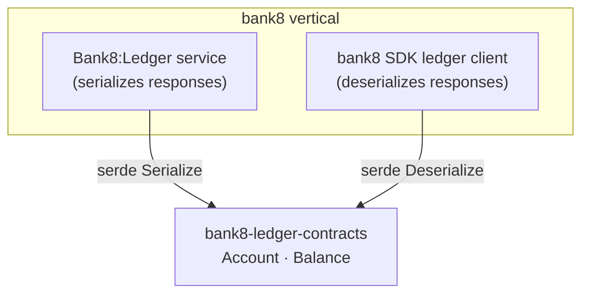

# bank8-ledger-contracts

Wire types for the Bank8:Ledger HTTP API - the shared vocabulary between
the ledger service, the `bank8` SDK client, and any Rust consumer of the
ledger's public REST surface.

## 1. Summary

`bank8-ledger-contracts` defines the serde DTOs exchanged with
Bank8:Ledger over HTTP (`Account`, `Balance`). It is the single source of
truth for the ledger wire format: the service handlers serialize these
types, the SDK client deserializes them, and both pin the same JSON shape
in their test suites.

## 2. Motivation

Without a shared contracts crate, the ledger service and every client
drift independently on wire shapes - field renames silently break
consumers at runtime. A dedicated contracts crate compiles the wire
format once, so a shape change is a compile error on both sides, and the
round-trip tests guarantee serialization stability (money stays a JSON
string).

## 3. Architecture & High-Level Design

The crate is deliberately tiny: pure data types, no I/O, no dependencies
beyond `serde`/`uuid`/`chrono`.

## 4. Key Traits and Data Structures

- `struct Account` - a ledger account as returned by `GET /v1/accounts`.
  `denomination` is an ISO 4217 currency code; `status` is the account
  lifecycle state (`OPEN`/`PENDING`/`CLOSED`).
- `struct Balance` - a point-in-time balance reading for one account.
  `amount` is a **JSON string** on the wire (money is never a float);
  `balance_type` names the balance phase (`AVAILABLE`, `COMMITTED`, …).

Both derive `Serialize`/`Deserialize`/`Clone`/`Debug` and nothing else -
no behavior lives here.

## 5. Rationale, Trade-offs, and Alternatives

- **String-typed money over `rust_decimal` in contracts**: the wire
  format is pinned as a string so JSON consumers in any language parse
  money without float rounding. The ledger service decodes into
  `rust_decimal` internally (see the ledger design §8.3); the contracts
  layer stays dependency-light.
- **No builder/validation logic**: contracts are inert data. Validation
  belongs to the service (reject at the boundary) and to consumers.
  This keeps the crate free of business rules that would duplicate the
  service's.
- **Rejected: one `bank8-contracts` crate for all services** - per-service
  contracts crates let a consumer depend on exactly one service's
  vocabulary (e.g. an app consuming only ledger) without pulling in
  payments/FDX types.

## 6. Internal Implementation & Invariants

- **Money-as-string invariant**: `Balance.amount` serializes as a JSON
  string; the round-trip test asserts the raw JSON contains
  `"amount":"…"` so any accidental numeric drift fails CI.
- **`env_id` on the wire**: `Account.env_id` is part of the public
  response shape (tenants see their own scope via RLS; the field is
  informational for clients, never an input they control).

## 7. Unresolved Questions / Future Designs

- Product, posting, and schedule wire types live in the SDK
  request/response structs today. Decision rule, not a TODO: the first
  non-SDK Rust consumer that needs them triggers the graduation - until
  then the crate stays minimal and a duplicate vocabulary is the bigger
  risk.

---

**Design attribution:** bank8:ledger and its underlying concepts were designed by Hamid Jahanzad <Hamid@Jahanzad.com>.
