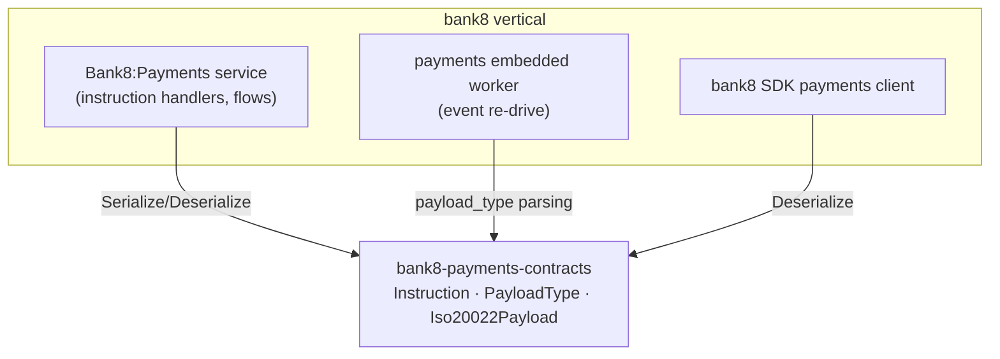

# bank8-payments-contracts

Wire types for the Bank8:Payments HTTP API - the shared vocabulary between
the payments service, the `bank8` SDK client, the embedded re-drive worker's event
payloads, and any Rust consumer of the payment-orchestration surface.

## 1. Summary

`bank8-payments-contracts` defines the serde DTOs exchanged with
Bank8:Payments over HTTP (`Instruction`, `Iso20022Payload`) plus the
typed ISO 20022 message catalogue (`PayloadType`) used by A2A and Card
payment flows. It is the single source of truth for the payments wire
format.

## 2. Motivation

Payment orchestration speaks ISO 20022: instructions carry typed
`pain.*`/`pacs.*`/`camt.*`/`cain.*` payloads, and both the service and
its consumers must agree on exactly which message codes are supported.
A shared contracts crate turns "which message types exist" into a
compile-time catalogue instead of scattered string literals, and the
serde tests pin the wire encoding (SCREAMING_SNAKE_CASE enum tags,
string amounts).

## 3. Architecture & High-Level Design

`PayloadType` is a closed enum over the fourteen supported ISO 20022
message codes; `Iso20022Payload` wraps a typed payload plus a
correlation `message_id`.

## 4. Key Traits and Data Structures

- `struct Instruction` - a payment instruction as returned by
  `GET /v1/instructions`. `state` is the instruction lifecycle state
  (see the payments design §4.6 state machine); `input`/`output` carry
  the scheme payload as JSON.
- `enum PayloadType` - the supported ISO 20022 message types, A2A
  (`pain.001`, `pacs.002`, `pacs.004`, `pacs.008`, `pacs.028`,
  `camt.029`, `camt.056`, `admi.007`) and Cards (`cain.001`, `cain.003`,
  `cain.006`, `cain.016`, `cain.023`, `caad.008`). Serializes as
  SCREAMING_SNAKE_CASE; `message_code()` maps back to the ISO dotted
  form.
- `struct Iso20022Payload` - `{payload_type, message_id, payload}` -
  the typed envelope every scheme flow carries.

## 5. Rationale, Trade-offs, and Alternatives

- **Closed enum over free strings**: `from_str_loose` accepts the ISO
  code case-insensitively, but construction is still total - unknown
  codes return `None` and the caller rejects, instead of an arbitrary
  string flowing through the pipeline.
- **`is_card()`/`is_a2a()` helpers**: the two flow families have
  different execution paths in the service (card flows go through the
  card simulator + scheme gateways; A2A flows through the instruction
  state machine); the split is a property of the type, so it lives here.
- **Rejected: raw `serde_json::Value` payloads everywhere** - the typed
  wrapper keeps the message code addressable for routing, audit, and
  DLQ triage without parsing the full payload.

## 6. Internal Implementation & Invariants

- **Round-trip stability**: enum serde form is
  `"FI_TO_FI_CUSTOMER_CREDIT_TRANSFER"` (SCREAMING_SNAKE_CASE) - pinned
  by test; changing a variant name is a wire break.
- **`from_str_loose` total mapping**: every variant is reachable through
  its ISO code; the mapping is asserted for all fourteen codes plus the
  negative case.
- **Optional output**: `Instruction.output` is
  `#[serde(skip_serializing_if = "Option::is_none")]` so in-flight
  instructions don't carry a `"output": null` key.

## 7. Unresolved Questions / Future Designs

- A typed model per message family (strong fields for amount/date/party)
  can layer over the same envelope without breaking the wire shape.
  Decision rule, not a TODO: the trigger is a third scheme flow needing
  the same `pain.001` field extraction - dedupe the typed structs then,
  not speculatively.

---

**Design attribution:** bank8:payments and its underlying concepts were designed by Hamid Jahanzad <Hamid@Jahanzad.com>.
