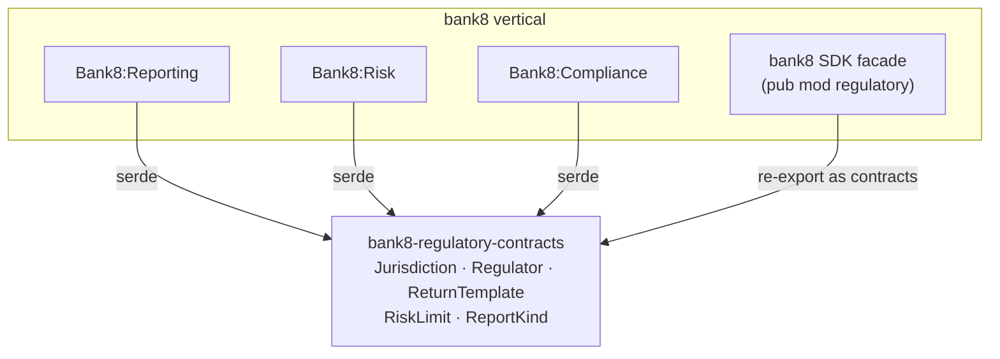

# bank8-regulatory-contracts

Wire types and the jurisdiction registry vocabulary shared across the
bank8 regulatory services (reporting, risk, compliance) — the shared
contract for regulator metadata, filing obligations, limits, and
suspicious-activity report kinds.

## 1. Summary

`bank8-regulatory-contracts` defines the serde DTOs exchanged between
the three regulatory services and the `bank8` SDK facade:
`Jurisdiction`, `Regulator`, `ReturnTemplate`, `RiskLimit`, and the
closed `ReportKind` enum (`Str`/`Sar`/`Ctr`/`Eftr`/`Lctr`).

## 2. Motivation

The three regulatory services share one jurisdiction registry and one
report-kind vocabulary. Without a shared crate each service would define
its own `Jurisdiction` and its own STR/SAR string constants, and the
registry would silently drift. A contracts crate makes the wire shape a
compile-time contract with round-trip tests, so drift fails the build.

## 3. Architecture & High-Level Design

The jurisdiction registry itself is runtime data (registry tables in the
`reporting` schema, provisioned from `vertical-registry.json` by
`vertical enroll`); these DTOs are only the wire shape — never the
source of truth, and never carrying regulator names in code.

## 4. Key Traits and Data Structures

- `struct Jurisdiction` — `country_code` + regulator list.
- `struct Regulator` — name, authority kind
  (`prudential`/`fiu`/`sanctions`/`conduct`), return templates.
- `struct ReturnTemplate` — return code, output format (`XBRL`/`CSV`),
  cadence (`daily`/`monthly`/`quarterly`/`annual`).
- `struct RiskLimit` — limit type, threshold (decimal), breach status.
- `enum ReportKind` — closed: `Str`, `Sar`, `Ctr`, `Eftr`, `Lctr`.

Pure data types: `Serialize`/`Deserialize`/`Clone`/`Debug` only — no
validation logic (each service owns its own validation, per the
fdx-contracts precedent).

## 5. Rationale, Trade-offs, and Alternatives

- **One registry vocabulary** — jurisdiction and report kinds are shared
  by all three services; a single crate prevents drift.
- **`ReportKind` as a closed enum** — the report-kind set is a
  slow-changing regulatory vocabulary (unlike FDX's open, tenant-
  configurable scope strings); a closed enum is safe here and gives
  exhaustive matching at the filing boundary.
- **Decimals as `rust_decimal::Decimal`** — thresholds are financial
  amounts; binary floats are unacceptable for a filing input.

## 6. Internal Implementation & Invariants

- **Round-trip stability**: the jurisdiction, limit, and report-kind
  JSON shapes are pinned by test; serialization drift fails the build.
- **No validation in the crate** — a DTO change is a wire change; the
  owning service's validation is where business rules live.

---

**Design attribution:** bank8:regulatory and its underlying concepts were designed by Hamid Jahanzad <Hamid@Jahanzad.com>.
