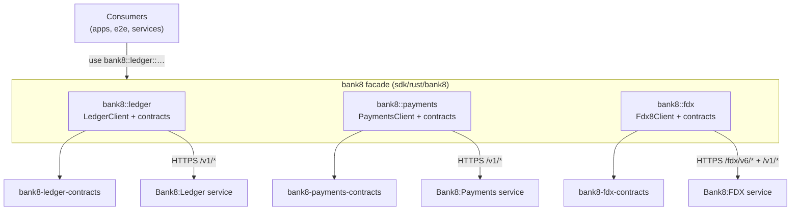

# bank8 - Rust namespace facade

The unified Rust entry point for the Bank8 vertical: SDK clients and
contracts for Bank8:Ledger, Bank8:Payments, and Bank8:FDX, imported as
`bank8::{service}::{…}`.

## 1. Summary

`bank8` is the workspace's namespace facade (architecture-principles
§2.1): every bank8 crate is reachable through this one crate, and
consumers never import a leaf crate directly. Each service module nests
its SDK client plus its contracts crate, giving applications one typed
client per backend service with correlation-ID propagation built in.

## 2. Motivation

Vertical consumers (apps, e2e tooling, internal services) need one
import surface that (a) hides the crate graph behind a stable namespace,
(b) enforces the same client conventions (builder pattern, bearer token,
correlation header) across all services, and (c) keeps zero vertical
knowledge inside the platform SDK (`sentin8` re-exports nothing
bank8-specific - architecture-principles §4.14).

## 3. Architecture & High-Level Design

The facade's shared plumbing (`ClientBuilder`, `CORRELATION_ID_HEADER`,
`prepare_request`) gives every client the same wire discipline:
a fresh UUID v4 correlation id per request and bearer auth when a token
is attached.

## 4. Key Traits and Data Structures

- `trait ClientBuilder` - the uniform builder contract every service
  client implements: `with_base_url`, `with_token`, `with_http_client`.
  Clients are cheap to clone (an inner `reqwest::Client` is reused).
- `LedgerClient` / `PaymentsClient` / `Fdx8Client` - typed async clients
  over each service's REST surface. Every method maps 1:1 to an endpoint,
  decodes into the contracts types, and returns the service's error enum
  (`LedgerError` / `PaymentsError` / `Fdx8Error`: transport, decode, and
  status variants).
- `CORRELATION_ID_HEADER` / `generate_correlation_id()` - the
  cross-service tracing convention: callers may propagate a correlation
  id upstream; the client always injects one when absent.

## 5. Rationale, Trade-offs, and Alternatives

- **Facade over direct leaf imports**: `bank8::{svc}` imports survive
  crate reorganizations behind the facade, and the workspace enforces
  the namespace rule mechanically - a consumer importing
  `bank8_ledger_contracts::…` directly is visible in review.
- **Method-per-endpoint over a generic HTTP caller**: the typed methods
  give compile-checked paths and decode types; a generic
  `get::<T>(path)` would re-introduce stringly-typed drift the contracts
  crates exist to prevent.
- **`reqwest` under the hood**: clients dial through Sentin8:Proxy with
  the platform TLS stack; `with_http_client` exists for tests (mockito)
  and for callers that need a custom TLS configuration.
- **Rejected: dynamic service discovery inside the client** - base URLs
  come from the caller (config/service discovery), keeping the SDK
  side-effect-free and unit-testable without a live platform.

## 6. Internal Implementation & Invariants

- Every request passes through `prepare_request` - no client method may
  bypass the correlation-id injection.
- Error enums never expose reqwest types; transport failures are mapped
  to the client's own `Http(String)` variant so consumers depend only
  on the facade.
- Doctests run against the real builder signatures (`no_run`) so the
  documented quick-start cannot rot.

## 7. Unresolved Questions / Future Designs

- Streaming/SSE helpers (ledger event streams, FDX notifications) are not
  in the SDK yet; consumers use the bus/`sse_consume` surface directly
  today. Decision rule, not a TODO: the first SDK consumer that must
  consume a bank8 event stream in-process triggers the helper crate.

---

**Architecture & Design:** bank8 (facade) and its underlying concepts were designed by [Hamid Jahanzad](https://www.linkedin.com/in/hamidjahanzad/).
